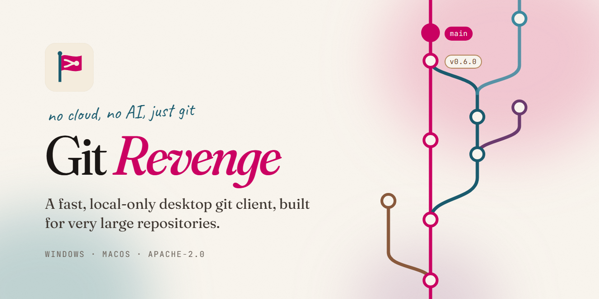

<p align="center">
  
</p>

Git Revenge is a desktop git client for Windows and macOS that stays fast on huge repositories. It's a Go app that drives the `git` you already have installed. There are no accounts, no cloud features and no AI.

> **Status:** early development. The latest release is [`0.8.0`](https://github.com/risadams/GitRevenge/releases/tag/v0.8.0), and `0.9.0` is in progress.

## What it does

- **A commit graph that copes with big histories.** It loads history just ahead of where you're scrolling instead of all at once. On the Linux kernel (1.5M commits) the first screen arrives in under half a second. Commits are in date order, with `main` pinned down the left as a spine. You can search, jump to any commit, and filter branches and tags.
- **Branch care.** Branches get kinds (Trunk, Release, Environment, Docs, Bot) that change how they look and behave. Hide the noise, clean up merged branches after a pull (squash merges included), sync git notes, and see stacked branches, with a one-click restack once the branch below merges.
- **Everyday git.** Stage whole files, hunks or single lines. Commit and amend (signed, if your git config signs). Stash, branch, tag, merge, rebase, cherry-pick, reset and revert, with undo and redo.
- **Digging through history.** Interactive rebase, a 3-pane conflict tool, file history, blame, the reflog, and git notes. Signed commits get a badge showing whether the signature checks out.
- **Diffs and previews.** Unified or split diffs with syntax highlighting and image diffs. Files can also be shown rendered: Markdown, SVG, images, CSV tables, JSON/YAML/TOML trees, LaTeX math, Mermaid diagrams and PDFs.
- **Remotes.** Fetch, pull and push through your existing credential helpers and SSH agent. If they can't answer, the app asks you.
- **Lots of repos at once.** Repos open in tabs, worktrees are supported, and a group of local projects gets a dashboard with batch fetch and pull.
- **LFS and submodules.** Track LFS patterns, see which files are in LFS, lock and unlock them. Initialize and update submodules.
- **Insights for sprint reviews.** What shipped in a window, which branches are stuck or would conflict, and where the hotspots are, all computed from the repository alone and reproducible, with Markdown and CSV exports.
- **Comfortable to live in.** Light and dark themes with subtle, reduced-motion-aware animation, a timeline graph with a compact mode, a settings panel, and a command palette (<kbd>Ctrl</kbd>+<kbd>K</kbd>). Common actions have shortcuts, which you can rebind; <kbd>Ctrl</kbd>+<kbd>/</kbd> lists them. On macOS, read <kbd>⌘</kbd> for <kbd>Ctrl</kbd>.

## Privacy

No accounts, no cloud sync, no telemetry. Git Revenge uses your own git config, credential helpers and SSH agent. The only request it makes on its own is a check of GitHub Releases for a newer version at startup, and you can turn that off in Settings.

## Install

Grab the Windows installer or the macOS disk image from the [latest release](https://github.com/risadams/GitRevenge/releases/latest).

- **macOS:** the disk image is signed and notarized (since 0.6.0).
- **Windows:** the installer isn't signed yet, so SmartScreen will warn you before it runs.

## Requirements

- `git` 2.40 or newer.
- `git-lfs`, if you want the LFS features.
- For very large repositories, a commit-graph file makes the first screen of the graph much faster. Run `git commit-graph write --reachable` once, or set `fetch.writeCommitGraph=true` to keep it up to date.

## Development

You'll need Go 1.27.3+, Node 24+, and the [Wails v2 CLI](https://wails.io/docs/gettingstarted/installation) at the version pinned in `go.mod`:

```sh
go install github.com/wailsapp/wails/v2/cmd/wails@v2.17.0
```

```sh
wails dev        # run with hot reload
wails build      # build build/bin/gitrevenge(.exe)
```

The Go binary embeds `frontend/dist`, so on a fresh clone build the frontend once before running Go tools directly:

```sh
cd frontend && npm ci && npm run build && cd ..
go test ./...
```

The frontend checks CI runs:

```sh
cd frontend && npm run check && npm run lint && npm test
```

The TypeScript bindings in `frontend/wailsjs` are generated from the Go API by `wails dev`, `wails build` or `wails generate module`. Commit them exactly as generated.

Performance checks run against a large repository of your choice; see [Performance targets](docs/PLAN.md#performance-targets).

## Docs

- [The documentation site](https://gitrevenge.com), with the user guide. Its source is `docs/`, and `docs-site/` builds it: `cd docs-site && npm ci && npm start`.
- [Plan](docs/PLAN.md): scope, architecture, performance targets, milestones and workflow.
- [Architecture decision records](docs/adr/).
- [Releasing](docs/RELEASING.md).
- [Accessibility](ACCESSIBILITY.md), [contributing](CONTRIBUTING.md), [code of conduct](CODE_OF_CONDUCT.md) and [security policy](SECURITY.md).
- Work is tracked in [issues](https://github.com/risadams/GitRevenge/issues), grouped by [milestone](https://github.com/risadams/GitRevenge/milestones).

## License

[Apache-2.0](LICENSE)
